# Tres Amigos v3 — Complete workflows, activiteitendiagrammen & ChatGPT-briefing

**Doel:** uitgebreid ontwerp- en briefingdocument voor product, development én ChatGPT.  
**Bron (as-is / v2):** monorepo `tresamigos` (NestJS + Prisma + Redis, React web + admin).  
**Datum:** oktober 2026.  
**Taal UI:** Nederlands · **identifiers:** Engels.

---

## Inhoudsopgave

1. [Samenvatting & personen](#1-samenvatting--personen)  
2. [Architectuur & domeinkaart](#2-architectuur--domeinkaart)  
3. [Spoor A — Multi-franchise pricing + webshop](#3-spoor-a--multi-franchise-pricing--webshop)  
4. [Spoor B — B2B facturatie, BTW & offerte](#4-spoor-b--b2b-facturatie-btw--offerte)  
6. [Integratie tussen de drie sporen](#6-integratie-tussen-de-drie-sporen)  
7. [Roadmap v3.1 → v3.3](#7-roadmap-v31--v33)  
8. [Risico’s, non-goals & acceptatiecriteria](#8-risicos-non-goals--acceptatiecriteria)  
9. [ChatGPT-prompt (uitgebreid, kopieerbaar)](#9-chatgpt-prompt-uitgebreid-kopieerbaar)  
10. [Codebase-index](#10-codebase-index)

---

## 1. Samenvatting & personen

### 1.1 Wat Tres Amigos v3 moet oplossen

| Probleem nu | Impact | v3-richting |
|-------------|--------|-------------|
| Prijzen per vestiging werken, maar “leeg = niet aanbieden” is onbetrouwbaar | Verkeerde catalogus | Expliciete delete/disable van prijsregels |
| Factuur-PDF zonder BTW-berekening | Niet boekhoudklaar | Excl / BTW / incl + tarieven 0/9/21 |
| Geen offerte-workflow | Handmatig buiten systeem | Offerte → accept → order → factuur |
| Owner mist gestructureerd operations-ritme | Ad-hoc admin | Activiteitendiagrammen + dashboard-signals |
| Seed overschreef vroeger CMS-foto’s | Dataverlies | Seed non-destructive (al deels gefixt) |

### 1.2 Personen (actors)

| Actor | Kanaal | Primaire doelen |
|-------|--------|-----------------|
| **Eigenaar / HQ** | Admin (`/admin`) | Vestigingen, prijzen, accounts, facturen, tellingen monitoren, offertes |
| **Admin-medewerker** | Admin (subset permissions) | Orders afhandelen, PDF’s, staff PIN’s |
| **Franchisehouder** | `/franchise/login` → `/franchise/shop` | Bestellen materialen/merch tegen vestigingsprijs |
| **Winkelmedewerker** | `/telling` | Ochtend/avond telling (PIN) |
| **Catering-klant (B2B)** | `/catering` | Event bestellen + bedrijfsgegevens |
| **Franchise-kandidaat** | `/franchise` | Aanvraag (apart van shop) |

### 1.3 Context diagram

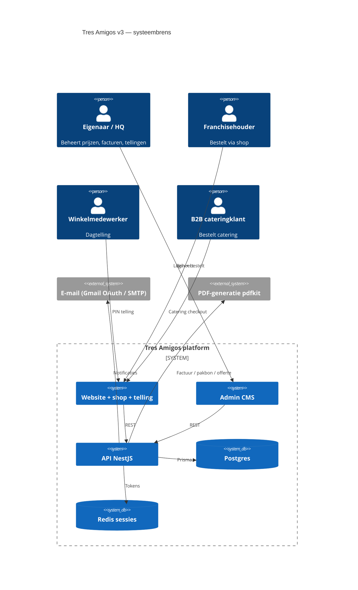

*(Als C4Context niet rendert in jouw viewer: gebruik het flowchart-overzicht in §2.)*

---

## 2. Architectuur & domeinkaart

### 2.1 Domeinen

| Domein | v2 status | v3 doel |
|--------|-----------|---------|
| **Multi-franchise pricing + shop** | ✅ Werkend | Hardening + self-service + mail |
| **B2B facturatie + BTW** | ⚠️ Light PDF | Volledige BTW + status + termijnen |
| **Offerte** | ❌ Ontbreekt | Nieuw, hergebruik order-PDF-patroon |
| **Operations / dagtelling** | ✅ Werkend | Owner-activiteiten + signals |
| **Gedeeld: Location** | ✅ | Blijft single source of truth voor vestigingen |

### 2.2 High-level flowchart

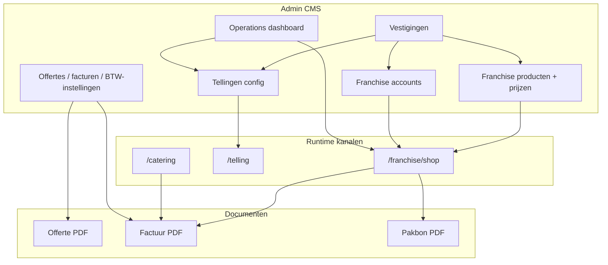

### 2.3 Gedeeld anker: Location

Alles wat “per shop” is, hangt aan `Location`:

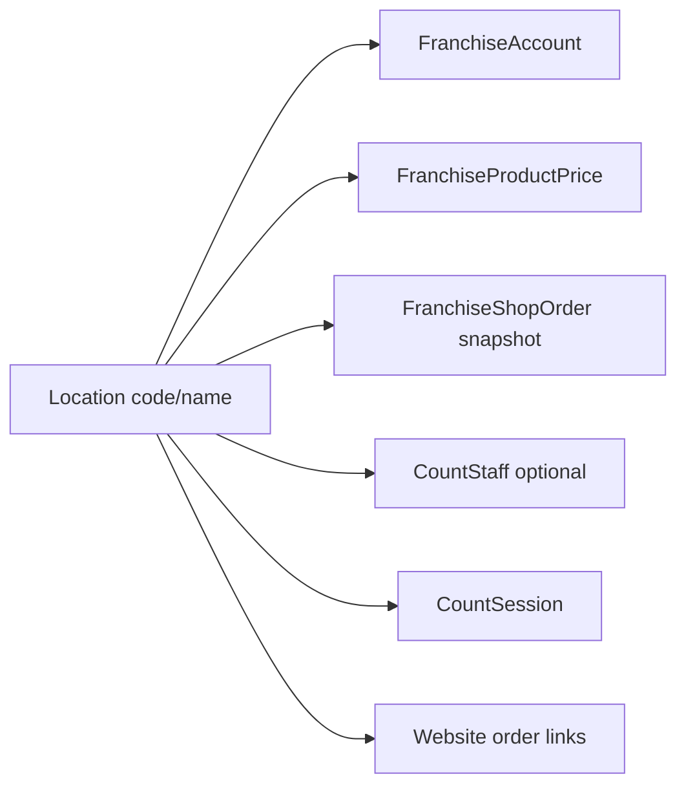

**Non-goal:** `CountProduct` en `FranchiseShopProduct` niet forceren tot één catalogus. Optioneel later: “inkoop-signaal” (telling laag → suggestie franchise-order).

---

## 3. Spoor A — Multi-franchise pricing + webshop

### 3.1 As-is datamodel

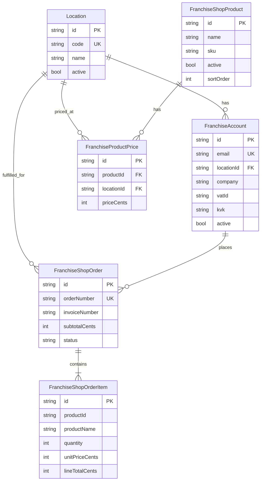

### 3.2 As-is sequence (volledig)

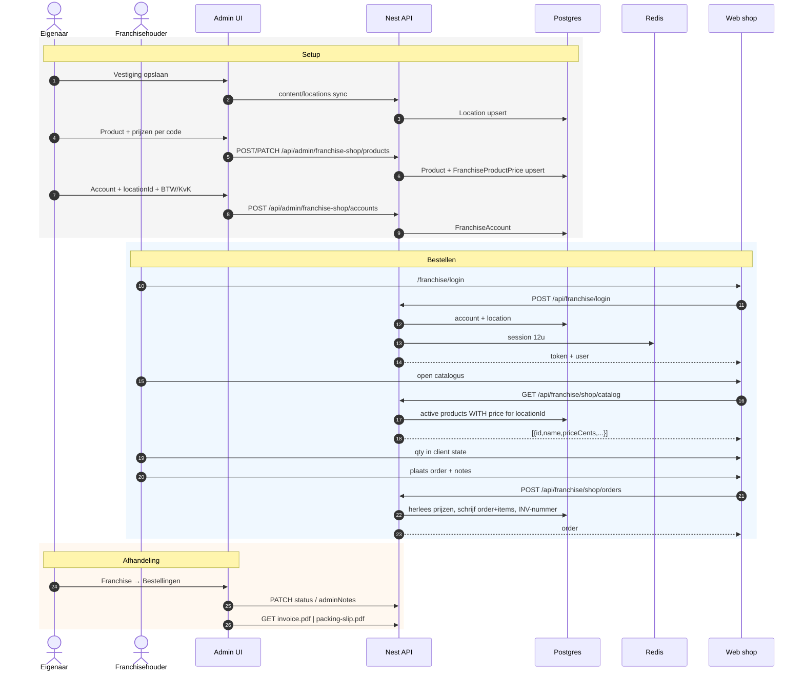

### 3.3 Activiteit — eigenaar (pricing & fulfillment)

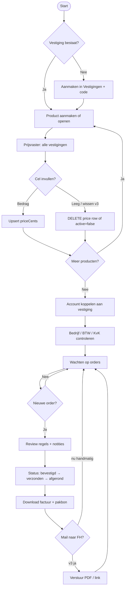

### 3.4 Activiteit — franchisehouder

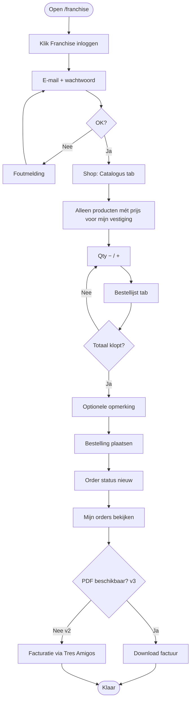

### 3.5 Order status machine (shop)

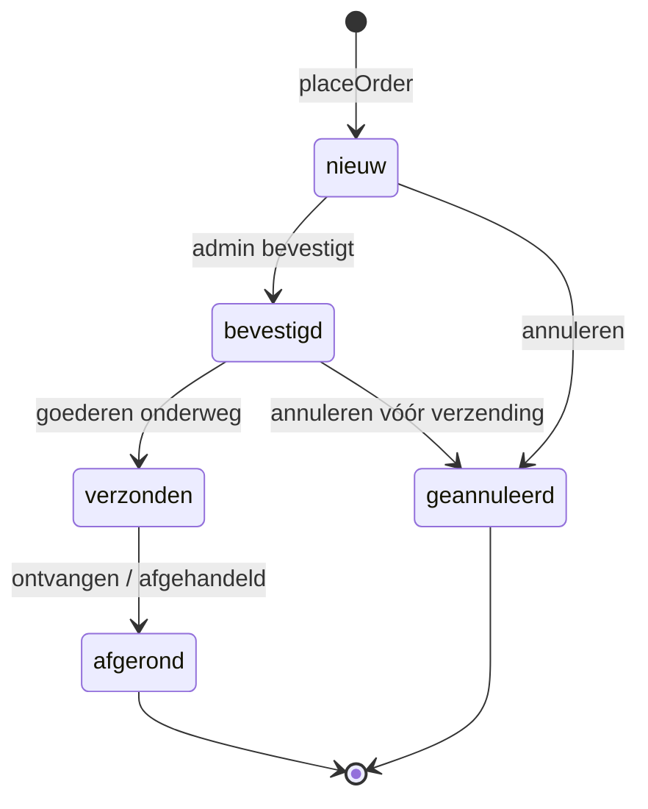

### 3.6 User stories — spoor A

**Owner**

1. Als eigenaar wil ik per vestiging een andere inkoop-/doorverkoopprijs zetten, zodat Nieuw-West niet dezelfde centen heeft als Oost.  
2. Als eigenaar wil ik een product tijdelijk niet aanbieden op één vestiging zonder het product globaal uit te zetten.  
3. Als eigenaar wil ik prijzen van vestiging A naar B kopiëren (bulk).  
4. Als eigenaar wil ik bij een nieuwe shop-order een e-mail + badge in admin.  
5. Als eigenaar wil ik factuur én pakbon in één klik, met klant-BTW/KvK van het account.

**Franchisehouder**

6. Als franchisehouder wil ik alleen producten zien die voor mijn vestiging geprijsd zijn.  
7. Als franchisehouder wil ik mijn bedrijfs-/BTW-gegevens zelf bijwerken.  
8. Als franchisehouder wil ik mijn eigen factuur-PDF downloaden.  
9. Als franchisehouder wil ik orderstatus zien (nieuw → … → afgerond).

### 3.7 API — as-is vs v3

| Methode | Pad | Actor | v2 | v3 toevoeging |
|---------|-----|-------|----|---------------|
| POST | `/api/franchise/login` | FH | ✅ | — |
| GET | `/api/franchise/shop/catalog` | FH | ✅ | cache-headers optioneel |
| POST | `/api/franchise/shop/orders` | FH | ✅ | mail event |
| GET | `/api/franchise/shop/orders` | FH | ✅ | — |
| GET | `/api/franchise/shop/orders/:id/invoice.pdf` | FH | ❌ | ✅ self-service |
| PATCH | `/api/franchise/me/billing` | FH | ❌ | company/vatId/kvk |
| POST | `/api/admin/franchise-shop/products` | Owner | ✅ | — |
| PATCH | `/api/admin/franchise-shop/products/:id` | Owner | ✅ | empty price = delete row |
| POST | `/api/admin/franchise-shop/products/:id/copy-prices` | Owner | ❌ | fromLocation → toLocation |
| GET/PATCH | `/api/admin/franchise-shop/orders` | Owner | ✅ | webhook/mail log |

### 3.8 v3 datamodel-delta (pricing)

```prisma
// Optioneel: expliciete beschikbaarheid i.p.v. alleen ontbrekende rij
model FranchiseProductPrice {
  // bestaand...
  active     Boolean  @default(true)  // NEW: false = niet in catalogus
  // of: DELETE row wanneer admin leeg laat
}

model FranchisePriceListCopyJob {
  id             String   @id @default(uuid())
  fromLocationId String
  toLocationId   String
  createdBy      String
  createdAt      DateTime @default(now())
  rowsCopied     Int
}
```

### 3.9 Acceptatiecriteria spoor A

- [ ] Catalogus FH toont 0 producten zonder prijs voor die `locationId`.  
- [ ] Leeg prijsveld in admin verwijdert of deactiveert de prijsrij (geen stale cents).  
- [ ] Orderregels bevatten snapshot `unitPriceCents` / `lineTotalCents` (niet live herberekend bij PDF).  
- [ ] Bulk copy prijzen A→B overschrijft alleen geselecteerde producten of alles (UI-keuze).  
- [ ] Nieuwe order → e-mail naar configured notify + admin list refresh.  
- [ ] FH kan factuur PDF downloaden voor eigen orders.

---

## 4. Spoor B — B2B facturatie, BTW & offerte

### 4.1 As-is vs gap

| Capabiliteit | Catering | Franchise shop | v3 nodig |
|--------------|----------|----------------|----------|
| company / vatId / kvk | Op order | Op account | Behouden + valideren |
| Factuurnummer | `CAT-INV-jaar-n` | `INV-jaar-n` | Stabiele serie (geen race) |
| PDF factuur/pakbon | ✅ | ✅ | + BTW-regels |
| BTW-bedrag in DB | ❌ | ❌ | ✅ |
| Offerte | ❌ | ❌ | ✅ nieuw |
| Factuurstatus PAID/VOID | ❌ | ❌ | ✅ |
| Due days / IBAN op PDF | ❌ (env seller) | ❌ | ✅ admin settings |
| Verkoper in admin | ❌ alleen env | ❌ | ✅ |

### 4.2 State machine — Offerte → Order → Factuur

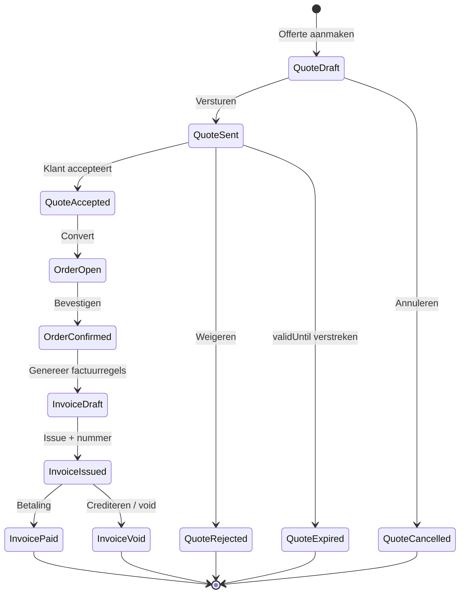

### 4.3 Sequence — offerte accept → factuur

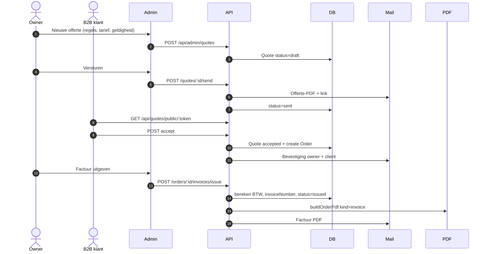

### 4.4 Activiteit — eigenaar B2B/BTW

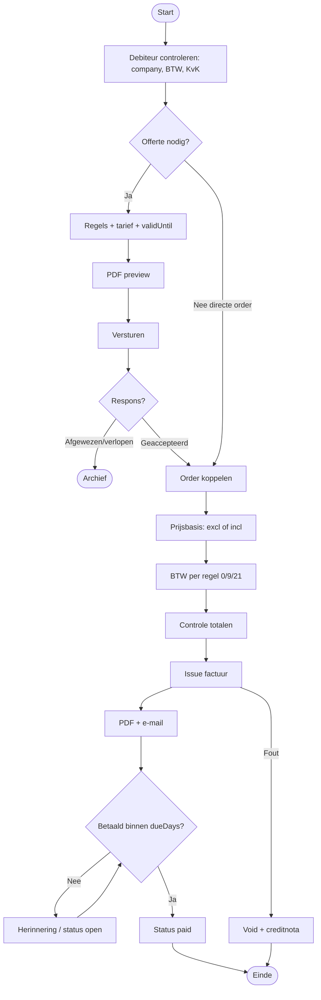

### 4.5 BTW-berekening (logica)

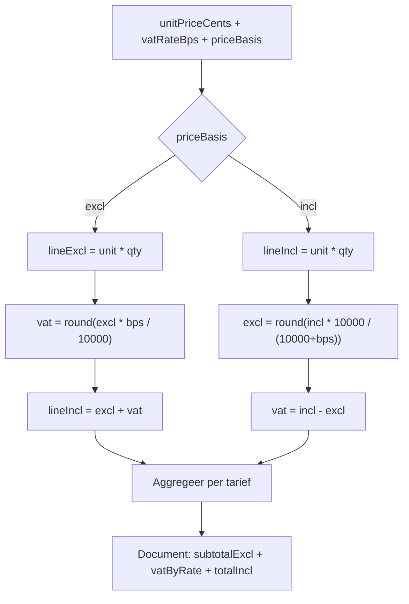

**Voorbeeld NL:** 21% → `vatRateBps = 2100`.  
**PDF:** expliciete regels “BTW 21% € …” + totaal incl.

### 4.6 Voorgesteld datamodel v3

```prisma
model BillingSettings {
  id                    String @id @default("primary")
  legalName             String
  tradeName             String @default("")
  address               String @default("")
  vatId                 String @default("")
  kvk                   String @default("")
  iban                  String @default("")
  invoiceEmail          String @default("")
  phone                 String @default("")
  defaultVatRateBps     Int    @default(2100)
  defaultDueDays        Int    @default(14)
  defaultPriceBasis     String @default("excl") // excl | incl
  invoiceFooter         String @default("")
  logoSrc               String @default("")
}

model Quote {
  id            String   @id @default(uuid())
  quoteNumber   String   @unique
  channel       String   // catering | franchise
  status        String   // draft|sent|accepted|rejected|expired|cancelled
  validUntil    DateTime?
  publicToken   String   @unique
  // party fields...
  company       String   @default("")
  vatId         String   @default("")
  kvk           String   @default("")
  subtotalExclCents Int  @default(0)
  vatCents      Int      @default(0)
  totalInclCents Int     @default(0)
  priceBasis    String   @default("excl")
  notes         String   @default("")
  orderId       String?  // na conversie
  items         Json
  createdAt     DateTime @default(now())
  updatedAt     DateTime @updatedAt
}

model Invoice {
  id              String   @id @default(uuid())
  invoiceNumber   String   @unique
  channel         String
  status          String   // draft|issued|paid|void
  orderId         String
  quoteId         String?
  dueAt           DateTime?
  issuedAt        DateTime?
  paidAt          DateTime?
  subtotalExclCents Int
  vatCents        Int
  totalInclCents  Int
  vatBreakdown    Json     // [{ rateBps, excl, vat }]
  partySnapshot   Json
  createdAt       DateTime @default(now())
}
```

Uitbreiding bestaande orders:

```prisma
// op CateringOrder / FranchiseShopOrder
priceBasis        String @default("excl")
subtotalExclCents Int    @default(0)
vatCents          Int    @default(0)
totalInclCents    Int    @default(0)
vatBreakdown      Json   @default("[]")
```

### 4.7 Activiteit — catering B2B checkout (klant)

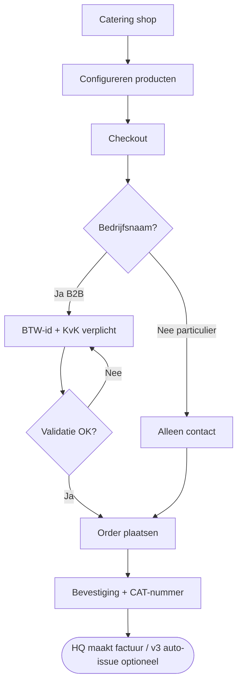

### 4.8 User stories — spoor B

1. Als eigenaar wil ik een offerte maken met geldigheid en PDF, zodat de klant kan tekenen/accepteren.  
2. Als eigenaar wil ik dat geaccepteerde offertes automatisch een order krijgen.  
3. Als eigenaar wil ik BTW 0/9/21 per regel en totalen excl/incl op de factuur.  
4. Als eigenaar wil ik factuurstatus (open/betaald/void) bijhouden.  
5. Als eigenaar wil ik verkopergegevens in admin zetten (niet alleen server-env).  
6. Als B2B-klant wil ik bij catering verplicht BTW+KvK als ik een bedrijf invul.  
7. Als franchisehouder wil ik mijn factuurgegevens in de shop beheren.  
8. Als boekhouder wil ik export van uitgegeven facturen met BTW-opsplitsing.

### 4.9 Hergebruik offerte-patronen

| Bouwsteen | Hergebruik van | Aanpassing |
|-----------|----------------|------------|
| Regelstructuur | `order-pdf` lines | + vatRateBps per line |
| PDF render | `buildOrderPdf` | `PdfDocKind = "quote" \| "invoice" \| "packing-slip" \| "credit"` |
| Admin download | CateringOrdersPanel / FranchiseShopPanel | + OffertesPanel |
| Nummering | INV / CAT-INV | + OFF-jaar-seq (transactional counter) |
| Ref-ferdiek | vat rate, dueDays, status, logo | Port naar `BillingSettings` |

### 4.10 Acceptatiecriteria spoor B

- [ ] Factuur-PDF toont subtotaal excl, BTW per tarief, totaal incl.  
- [ ] Som van regel-BTW = document-BTW (afrondingsregel gedocumenteerd).  
- [ ] Offerte public token werkt zonder admin-login.  
- [ ] Accept offerte is idempotent.  
- [ ] Void factuur blokkeert “paid”.  
- [ ] Migratie: oude orders zonder vat → `vatCents=0`, `totalInclCents=subtotalCents` of geconfigureerde default.

---

## 5. Spoor C — Operations & dagtelling (owner)

### 5.1 As-is datamodel

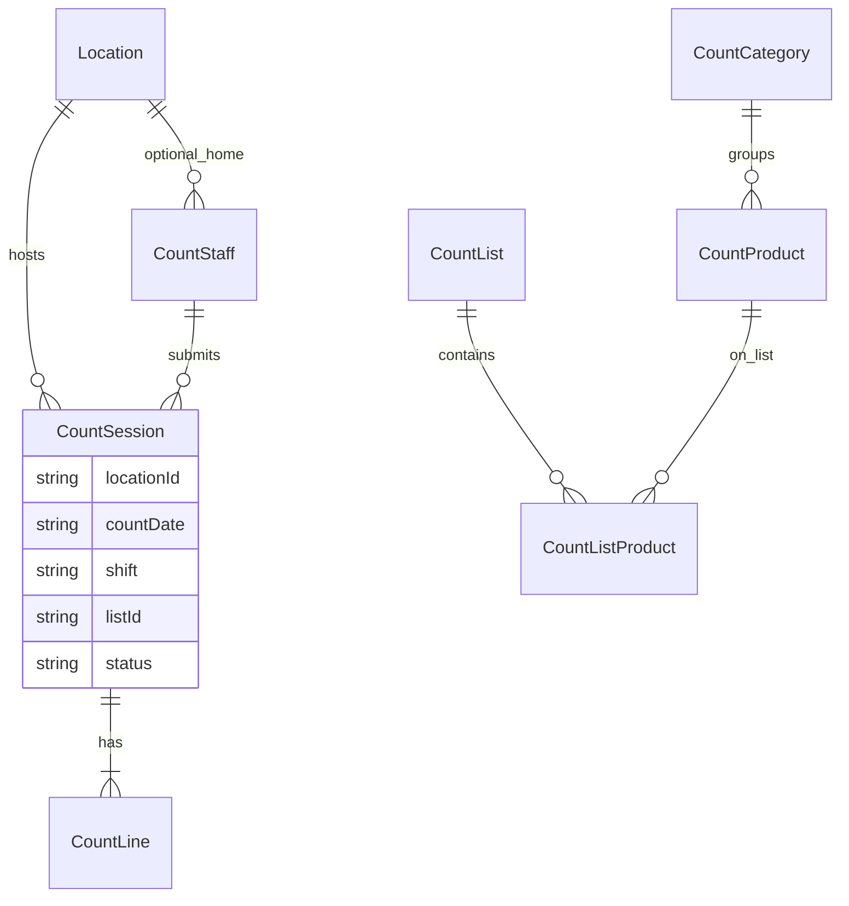

Uniek: `(locationId, countDate, shift, listId)`.  
Status: `draft` | `submitted` (geen approve).

### 5.2 Sequence — staff telling

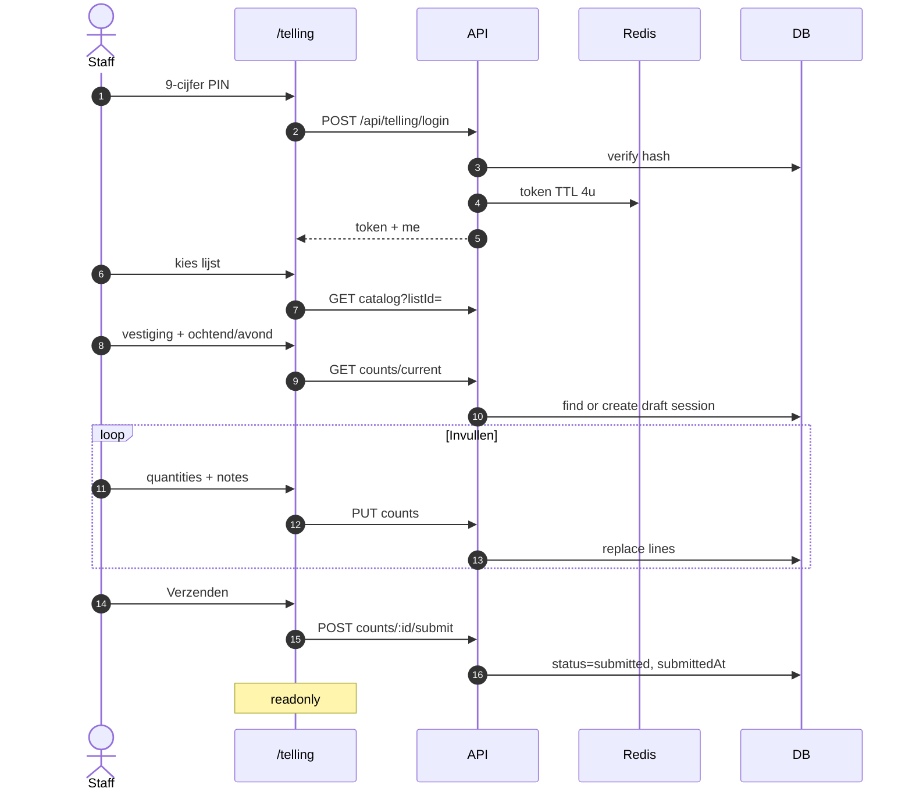

### 5.3 Activiteit — medewerker

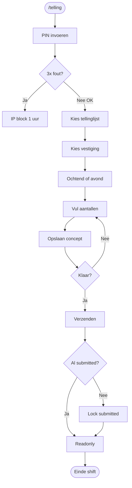

### 5.4 Activiteit — eigenaar (operations) — UITGEBREID

Dit is het kernritme voor de eigenaar:

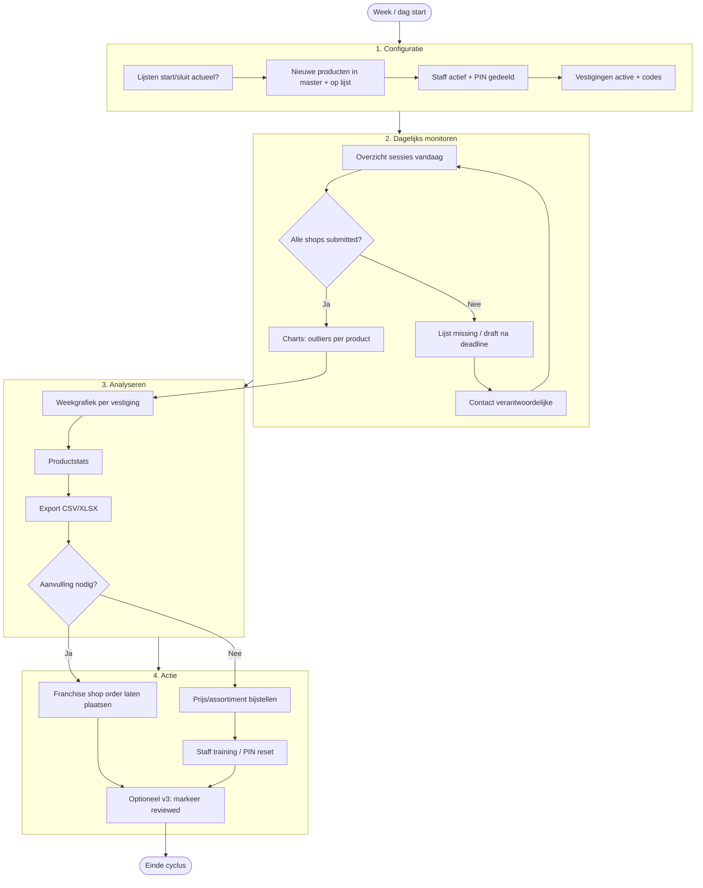

### 5.5 Swimlane — eigenaar vs vestiging vs systeem

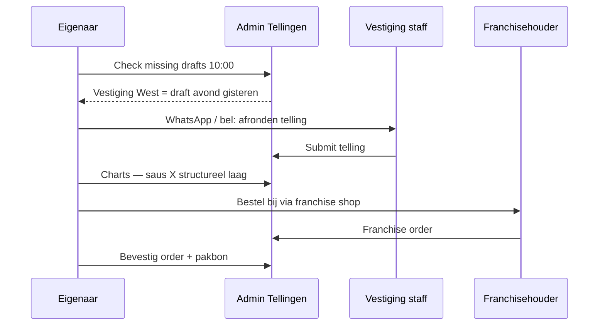

### 5.6 Owner weekkalender (normatief)

| Dag | Activiteit | Admin-view |
|-----|------------|------------|
| Ma | Catalogus/lijsten bijwerken | Producten + Lijsten |
| Di–Zo ochtend | Missing ochtend-tellingen | Overzicht filter vandaag + draft |
| Di–Zo avond | Missing avond-tellingen | idem shift=evening |
| Wo | Productcharts outliers | Product charts |
| Vr | Weekexport + voorraadgesprek | Export |
| Fr/Za | Franchise orders bundelen | Franchise bestellingen |

### 5.7 User stories — spoor C

1. Als eigenaar wil ik in één scherm zien welke vestigingen vandaag nog niet hebben verzonden.  
2. Als eigenaar wil ik deadline-alerts (bijv. ochtend vóór 12:00).  
3. Als eigenaar wil ik outliers (afwijking > X% vs 4-weeks average) zien.  
4. Als eigenaar wil ik vanuit een outlier doorklikken naar “maak franchise-order suggestie”.  
5. Als eigenaar wil ik session detail readonly kunnen exporteren.  
6. Als medewerker wil ik na submit niets meer kunnen wijzigen.  
7. Als medewerker wil ik bij verkeerde PIN duidelijk feedback (zonder account enumeration).

### 5.8 v3 optionele uitbreidingen (niet breaking)

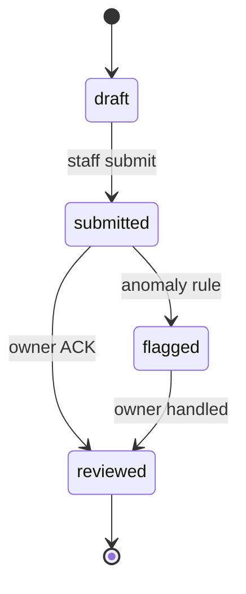

Velden: `reviewedAt`, `reviewedBy`, `flagReason`.  
Admin blijft backwards compatible als flags uit staan.

### 5.9 Acceptatiecriteria spoor C

- [ ] Unieke constraint voorkomt dubbele sessies zelfde key.  
- [ ] Submitted sessie is immutable via API.  
- [ ] Owner dashboard toont missing count per shift/location.  
- [ ] Export bevat locationCode, shift, list, product, qty.  
- [ ] Geen verplichte koppeling aan franchise producten.

---

## 6. Integratie tussen de drie sporen

### 6.1 End-to-end eigenaar (v3)

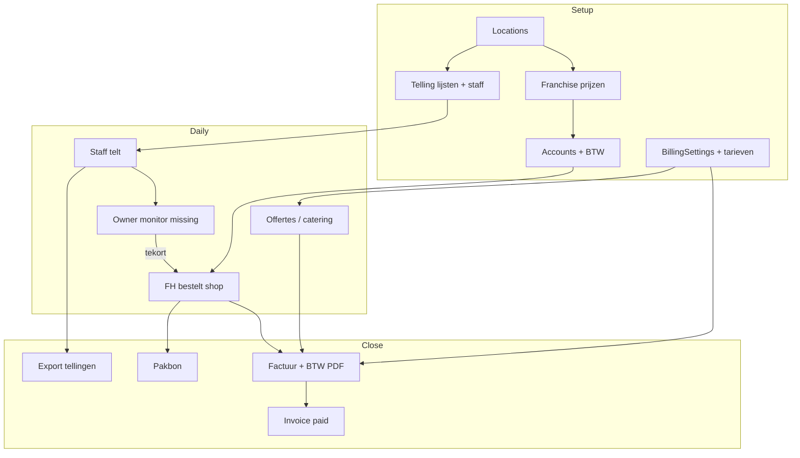

### 6.2 Beslisboom: welk document?

```mermaid
flowchart TD
  Q[Wat wil de klant?] --> A{Prijsopgave vóór akkoord?}
  A -->|Ja| OFF[Offerte PDF]
  A -->|Nee| ORD{Order bestaat?}
  OFF -->|Accept| ORD
  ORD -->|Ja goederen| PACK[Pakbon]
  ORD -->|Ja betalen| INV[Factuur + BTW]
  INV --> PAID{Betaald?}
  PAID -->|Nee| REM[Herinnering]
  PAID -->|Ja| DONE[Paid]
```

### 6.3 RACI (samenvatting)

| Activiteit | Owner | Admin | FH | Staff |
|------------|:-----:|:-----:|:--:|:-----:|
| Vestiging/prijs | A/R | C | I | — |
| Shop order plaatsen | I | C | R | — |
| Factuur issue | A/R | R | I | — |
| Telling invullen | I | C | — | R |
| Telling monitoren | A/R | R | — | I |
| Offerte | A/R | R | C* | — |

\*Franchise-offerte optioneel; catering-offerte typisch HQ↔klant.

---

## 7. Roadmap v3.1 → v3.3

```mermaid
gantt
  title Tres Amigos v3 roadmap
  dateFormat  YYYY-MM-DD
  section v3.1 BTW+PDF
  BillingSettings admin           :a1, 2026-11-01, 10d
  Order BTW velden + migratie     :a2, after a1, 10d
  PDF excl/BTW/incl               :a3, after a2, 7d
  section v3.2 Offerte
  Quote model + PDF               :b1, after a3, 14d
  Public accept flow              :b2, after b1, 10d
  Convert → order                 :b3, after b2, 7d
  section v3.3 Shop+Ops
  Price delete/bulk copy          :c1, after a3, 10d
  FH self-service + PDF           :c2, after c1, 10d
  Order mail notifications        :c3, after c2, 5d
  Owner missing-telling dashboard :c4, after c1, 12d
  Anomaly flags optioneel         :c5, after c4, 10d
```

| Release | Scope | Definition of Done |
|---------|-------|--------------------|
| **v3.1** | BTW op catering + franchise orders + PDF + BillingSettings | Boekhouder kan factuur lezen zonder voetnoot-only |
| **v3.2** | Offertes + accept + convert | Eerste echte B2B-deal via offerte in systeem |
| **v3.3** | Shop hardening + owner ops dashboard | Geen stale prijzen; missing tellingen < 1 klik |

---

## 8. Risico’s, non-goals & acceptatiecriteria

### 8.1 Risico’s

| Risico | Mitigatie |
|--------|-----------|
| Factuurnummer via `count()` → gaps/duplicates onder concurrency | Dedicated `InvoiceSequence` tabel + transaction |
| Afronding BTW per regel vs document | Kies én documenteer: round-per-line, sum |
| Seed overschrijft content | Seed blijft create-if-missing (pageMedia merge only) |
| Fiscaliteit NL / factuurvereisten | Juridische review op PDF-velden |
| Gmail OAuth restricted scopes | Publish + verification; privacy/terms URLs live |
| FH ziet verkeerde prijs door cache | Geen lange cache op catalog; re-price server-side bij order |

### 8.2 Non-goals (v3)

- Geen volledige ERP/boekhoudkoppeling (Exact/Twinfield) in v3.1.  
- Geen samensmelting CountProduct ↔ FranchiseShopProduct.  
- Geen online payment gateway verplicht voor franchise shop (blijft “facturatie via Tres Amigos”).  
- Geen multi-currency.

### 8.3 Globale acceptatie

- [ ] Alle Mermaid-flows hierboven zijn geïmplementeerd of expliciet als “later” gemarkeerd.  
- [ ] Privacy `/privacy` en Terms `/terms` blijven bereikbaar (Google OAuth).  
- [ ] Admin permissions: `franchise` / `franchiseShop`, `tellingen`, nieuw `billing` of `quotes`.  
- [ ] Testdata: 2 vestigingen, verschillende prijzen, 1 B2B catering, 1 telling submitted.

---

## 9. ChatGPT-prompt (uitgebreid, kopieerbaar)

Plak het volgende blok **in zijn geheel** in ChatGPT (of Claude). Vraag daarna per spoor om diepere uitwerking.

````markdown
# Rol
Je bent principal product architect + NestJS/Prisma/React engineer. Je ontwerpt **Tres Amigos v3** bovenop een bestaande v2 monorepo. Lever implementeerbare specs: Prisma-modellen, API-routes, UI-schermen, Mermaid (sequence + activity + state), migratiepad, acceptatiecriteria. Geen generieke SaaS-filler.

# Product
Multi-vestiging Mexican street food (Amsterdam). Stack: pnpm monorepo, NestJS API, Prisma/Postgres, Redis, React website, React admin.

# Personen
- Eigenaar/HQ (admin)
- Franchisehouder (/franchise/shop)
- Winkelmedewerker (/telling, 9-cijfer PIN)
- B2B cateringklant (/catering)
- Franchise-kandidaat (/franchise aanvraag — apart van shop)

# v2 AS-IS (feit — niet herontwerpen tenzij gap)

## A. Franchise shop + multi-location pricing
- Location { id, code unique, name, area, address, active }
- FranchiseShopProduct { name, description, image, sku, active, sortOrder } — GEEN globale prijs
- FranchiseProductPrice { productId, locationId, priceCents } @@unique([productId, locationId])
- FranchiseAccount { email unique, passwordHash, locationId, company, vatId, kvk, active }
- Catalog API: alleen active products WITH price for session locationId
- Web: /franchise/login → /franchise/shop; client-side cart; POST orders
- Order: FS-#####, invoiceNumber INV-{year}-{n}, statuses nieuw|bevestigd|verzonden|afgerond|geannuleerd
- Line snapshot unitPriceCents/lineTotalCents; server herleest prijs bij placeOrder
- Admin: Franchise → producten (prijsgrid), accounts, bestellingen; PDF invoice+packing via documents/order-pdf.ts
- Seller on PDF: COMPANY_* env; buyer: account company/vatId/kvk
- Gaps: empty price in admin does not reliably remove DB row; no order email; FH cannot download PDF; no VAT math

## B. B2B / invoicing light
- CateringOrder: company, vatId, kvk on order; if company then vatId+kvk required; CAT-INV numbers; items JSON with cents
- Franchise B2B fields on account not order
- Shared PDF: kinds invoice|packing-slip; channel catering|franchise; footnote “BTW volgens afspraken” — NO vatCents
- NO Quote model. Reference patterns in .ref-ferdiek: invoiceVatRateBasisPoints, dueDays, ISSUED/PAID/VOID, logo upload

## C. Tellingen (operations)
- /telling PIN 9 digits; Redis session; lists; location; shift morning|evening; draft|submitted
- Unique (locationId, countDate, shift, listId)
- Admin: catalog, lists, staff, overview, charts, export — NO approve workflow
- Shares Location with franchise; CountProduct ≠ FranchiseShopProduct

## Also relevant
- Seed must NOT overwrite admin pageMedia/site content (create-if-missing / merge missing keys only)
- Public legal pages /privacy and /terms exist for Google OAuth
- Gmail OAuth for mail relay; app must be In production + privacy/terms URLs

# Opdracht — ontwerp v3 in 3 sporen

## Spoor 1 — Pricing & shop
Deliver:
1. Fix empty-price semantics (delete or active=false) + API contract
2. Bulk copy prices location A→B
3. Email on new franchise order
4. FH self-service billing + PDF download
5. Mermaid: sequence owner setup, activity FH order, state order statuses
6. User stories + acceptance criteria
7. Prisma delta + endpoint table

## Spoor 2 — B2B BTW + offerte
Deliver:
1. BillingSettings (admin, not only env)
2. Quote entity + public accept token + convert to CateringOrder OR FranchiseShopOrder
3. VAT module: priceBasis excl|incl; rates 0/9/21 as basis points; line+doc totals; PDF layout
4. Invoice status draft|issued|paid|void; dueDays; credit note approach
5. Safe invoice sequencing under concurrency
6. Migration plan for existing orders without VAT fields
7. Mermaid: state offerte→factuur; activity owner B2B; sequence accept→issue
8. What to reuse from order-pdf.ts and .ref-ferdiek

## Spoor 3 — Owner operations / dagtelling
Deliver:
1. Owner daily/weekly activity diagram (config → monitor missing → charts → export → franchise replenishment)
2. Swimlane owner ↔ staff ↔ franchisee
3. Optional v3: reviewed/flagged states without breaking v2 clients
4. Dashboard wireframe description (missing drafts by location/shift)
5. Explicit non-merge of count vs shop catalogs; optional “signal” only
6. Mermaid activity + sequence follow-up missing telling

# Leverformat (verplicht)
1. Executive summary ≤20 regels
2. Per spoor: personas, user stories (min 6), Prisma delta, API table, UI screens, Mermaid (min 3 diagrammen), acceptance checklist
3. Cross-cutting: Location as integration hub; RACI; non-goals
4. Roadmap v3.1 (VAT+PDF), v3.2 (quotes), v3.3 (shop hardening + ops dashboard) with DoD
5. Risks: numbering races, VAT rounding, seed safety, OAuth verification
6. Write UI strings suggestions in Dutch

# Constraints
- Keep routes /franchise/shop and /telling
- Don’t rewrite catering product configurator unless needed for VAT lines
- Prefer additive migrations
- Assume NL tax rates; document rounding rule

# Eerste antwoord
Begin met executive summary + Mermaid domeinkaart + daarna Spoor 1 volledig. Wacht mijn “door met spoor 2” voordat je spoor 2/3 even diep uitwerkt — tenzij ik “alles in één keer” zeg.
````

**Variant:** stuur ChatGPT eerst alleen het documentpad-samenvatting + prompt, en upload daarna dit hele `.md` bestand als knowledge.

---

## 10. Codebase-index

| Onderdeel | Pad |
|-----------|-----|
| Prisma schema | `apps/api/prisma/schema.prisma` |
| Franchise shop service | `apps/api/src/franchise/franchise-shop.service.ts` |
| Franchise shop controller | `apps/api/src/franchise/franchise-shop.controller.ts` |
| Franchise auth | `apps/api/src/franchise/franchise-shop-auth.service.ts` |
| PDF builder | `apps/api/src/documents/order-pdf.ts` |
| Catering orders + PDF | `apps/api/src/catering/catering.service.ts` |
| Tellingen service | `apps/api/src/tellingen/tellingen.service.ts` |
| Web shop UI | `apps/web/src/pages/FranchiseShopPages.tsx` |
| Web telling UI | `apps/web/src/pages/TellingPage.tsx` |
| Admin franchise | `apps/admin/src/components/FranchiseShopPanel.tsx`, `FranchisePanel.tsx` |
| Admin tellingen | `apps/admin/src/components/TellingenPanel.tsx` + `telling/*` |
| Types | `packages/types/src/index.ts` |
| Seed (non-destructive site) | `apps/api/prisma/seed.ts` |
| Legal pages | `apps/web/src/pages/LegalPages.tsx` |
| Ref factuurpatronen | `.ref-ferdiek/admin/AdminPortal.tsx` |

---

## 11. HQ (Vilmon) vs franchisehouder — operatie & betalen

Dit is de **praktijkflow**: wat HQ in de admin doet voor de franchisehouder, en hoe de franchisehouder daarna moet kunnen betalen.

### 11.1 Wat HQ doet (voor de franchisehouder)

HQ (Vilmon) beheert in de admin vier sporen. De franchisehouder merkt daarvan vooral: **juiste prijzen**, **geleverde goederen**, **factuur**, en **of het account mag bestellen**.

```mermaid
flowchart TD
    A["Vilmon logt in op admin"] --> B["Franchisebeheer openen"]
    B --> C{"Welke activiteit?"}

    C -->|Productbeheer| D["Producten en assortiment beheren"]
    D --> E["Prijzen per vestiging instellen"]
    E --> B

    C -->|Bestellingen| F["Binnengekomen orders bekijken"]
    F --> G["Bestelling controleren"]
    G --> H["Order bevestigen"]
    H --> I["Pakbon genereren"]
    I --> J["Goederen gereedmaken en leveren"]
    J --> K["Medewerker controleert levering"]
    K --> L{"Pakbon akkoord?"}
    L -->|Nee| M["Afwijking afhandelen"]
    M --> K
    L -->|Ja| N["Order afronden"]

    C -->|Betalingen| O["Openstaande facturen bekijken"]
    O --> P{"Betaaltermijn verstreken?"}
    P -->|Nee| Q["Factuur blijven monitoren"]
    P -->|Ja| R["Betalingsherinnering"]
    R --> S["Betalingshistorie beoordelen"]
    S --> T{"Structureel te laat?"}
    T -->|Nee| Q
    T -->|Ja| U["Franchisehouder waarschuwen"]
    U --> V{"Account blokkeren?"}
    V -->|Nee| Q
    V -->|Ja| W["Bestellingen blokkeren"]
    W --> X["Openstaande betalingen opvolgen"]
    X --> Y{"Deblokkeren?"}
    Y -->|Nee| X
    Y -->|Ja| Z["Account weer actief"]

    C -->|Franchiseaccounts| AA["Accounts en vestigingen beheren"]
    AA --> AB["Account activeren of deactiveren"]
    AB --> B

    classDef blocked fill:#FEE2E2,stroke:#DC2626,color:#7F1D1D
    classDef success fill:#DCFCE7,stroke:#16A34A,color:#14532D
    class W blocked
    class N,Z success
```

| HQ-activiteit | Wat de franchisehouder merkt |
|---------------|------------------------------|
| Producten + prijzen per vestiging | Alleen geprijsde producten in zijn shop, juiste euro’s |
| Order bevestigen → pakbon → leveren → afronden | Status in “Mijn orders”; goederen binnen |
| Factuur uitgeven + herinneringen | PDF / e-mail met bedrag + vervaldatum |
| Account blokkeren bij wanbetaling | Kan niet meer bestellen tot schuld is opgelost |
| Account activeren/deactiveren | Wel of geen toegang tot `/franchise/shop` |

**Kort:** HQ is inkoper/logistiek + crediteur. De franchisehouder bestelt; HQ levert en factureert; HQ mag bestellen stopzetten bij structureel te late betaling.

### 11.2 Swimlane — HQ levert, FH ontvangt

```mermaid
sequenceDiagram
  autonumber
  actor FH as Franchisehouder
  actor HQ as Vilmon HQ
  participant Shop as Franchise shop
  participant Admin as Admin
  participant Ware as Magazijn / bezorging

  FH->>Shop: Bestelling plaatsen
  Shop-->>Admin: Order status nieuw
  HQ->>Admin: Controleren + bevestigen
  HQ->>Admin: Pakbon genereren
  HQ->>Ware: Picken / inpakken
  Ware->>FH: Leveren + pakbon
  FH->>Ware: Controleren levering
  alt Afwijking
    FH-->>HQ: Meld tekort / schade
    HQ->>Admin: Afwijking afhandelen
  else Akkoord
    HQ->>Admin: Order afronden
  end
  HQ->>Admin: Factuur uitgeven (BTW)
  Admin-->>FH: Factuur PDF / e-mail
```

### 11.3 Hoe de franchisehouder moet kunnen betalen (v3)

**Nu (v2):** shop zegt “Facturatie via Tres Amigos” — geen betaalknop, geen iDEAL in de shop. Betalen gebeurt buiten het systeem (overschrijving).

**Doel (v3):** factuur is leidend; FH ziet openstaand bedrag en kan betalen of betaalbewijs volgen.

```mermaid
flowchart TD
  A["Franchisehouder logt in op shop"] --> B["Tab: Facturen / betalingen"]
  B --> C{"Openstaande factuur?"}
  C -->|Nee| D["Alleen historie + PDF's"]
  C -->|Ja| E["Factuur openen: bedrag, BTW, vervaldatum"]
  E --> F{"Hoe betalen?"}

  F -->|iDEAL / Mollie| G["Betaallink starten"]
  G --> H{"Betaling gelukt?"}
  H -->|Nee| I["Opnieuw proberen of andere methode"]
  I --> F
  H -->|Ja| J["Webhook: factuur status = betaald"]
  J --> K["Order/account vrijgeven indien geblokkeerd"]

  F -->|Handmatige overschrijving| L["Toon IBAN + kenmerk = factuurnummer"]
  L --> M["FH boekt over via bank"]
  M --> N["HQ markeert factuur als betaald in admin"]
  N --> K

  K --> O["Bevestiging in shop + e-mail"]
  D --> P([Klaar])
  O --> P

  classDef success fill:#DCFCE7,stroke:#16A34A,color:#14532D
  classDef pay fill:#DBEAFE,stroke:#2563EB,color:#1E3A8A
  class J,K,O success
  class G,L pay
```

### 11.4 Betaalregels (afspraak product)

| Regel | Toelichting |
|-------|-------------|
| **Factuur eerst** | Bestelling ≠ betaling. Eerst levering (of bevestiging), dan factuur met vervaldatum (`dueDays`). |
| **Kenmerk** | Bij overschrijving altijd `invoiceNumber` als betalingskenmerk. |
| **Twee kanalen** | (1) Online: Mollie/iDEAL-link op factuur. (2) Bankoverschrijving + HQ bevestigt. |
| **Te laat** | HQ stuurt herinnering → bij herhaaldelijk te laat: waarschuwing → optioneel **bestelblok** tot betaald. |
| **Deblokkeren** | Pas als openstaande facturen `paid` zijn (of HQ uitzondering geeft). |
| **Geen checkout-betaling in cart** | Franchise shop blijft B2B op rekening; geen “pay before order” tenzij later expliciet gekozen. |

### 11.5 Activiteit — franchisehouder betalen (detail)

```mermaid
flowchart TD
  Start([Factuur ontvangen]) --> See[Open in e-mail of shop]
  See --> Check[Controleer regels + BTW + totaal]
  Check --> Ok{Klopt factuur?}
  Ok -->|Nee| Dispute[Contact HQ / betwisting]
  Dispute --> HQFix[HQ corrigeert of creditnota]
  HQFix --> See
  Ok -->|Ja| Method{Betaalmethode}
  Method -->|iDEAL| PayOnline[Betaal via link]
  Method -->|Overschrijving| Transfer[Bank: IBAN + factuurnr]
  PayOnline --> WaitAuto[Automatisch status paid]
  Transfer --> WaitHQ[Wacht op verwerking HQ]
  WaitHQ --> Paid[Status paid]
  WaitAuto --> Paid
  Paid --> Unblock{Was account geblokkeerd?}
  Unblock -->|Ja| Free[Weer bestellen mogelijk]
  Unblock -->|Nee| End([Klaar])
  Free --> End
```

### 11.6 Wat bouwen t.o.v. v2

| Onderdeel | v2 | v3 nodig |
|-----------|----|----------|
| Order + pakbon + factuur-PDF (admin) | deels | behouden + BTW |
| Factuurstatus open/betaald | ❌ | ✅ |
| FH-scherm “Mijn facturen” | ❌ | ✅ |
| iDEAL/Mollie betaallink | ❌ | optioneel v3.2/3.3 |
| Handmatige “markeer betaald” door HQ | ❌ | ✅ eerst |
| Bestelblok bij openstaande posten | account `active` alleen | ✅ koppelen aan open invoices |

**Implementatievolgorde (pragmatisch):**  
1) Factuurstatus + due date + HQ “markeer betaald” + herinnering-mail.  
2) FH “Mijn facturen” + PDF download.  
3) Bestelblok-regel.  
4) Daarna pas Mollie/iDEAL.

---

## Bijlage A — Glosarium

| Term | Betekenis |
|------|-----------|
| `priceCents` | Prijs in eurocenten (1250 = €12,50) |
| `vatRateBps` | BTW in basispunten (2100 = 21%) |
| `priceBasis` | Of unit prices excl. of incl. BTW zijn |
| Shift | `morning` / `evening` bij telling |
| FS-order | Franchise shop order |
| Pakbon | Packing slip zonder bedragen |
| Location code | Vestigingsnummer `001`… |

## Bijlage B — Checklist voor gesprek met ChatGPT

1. Plak §9 prompt.  
2. Upload dit bestand.  
3. Zeg: “Werk spoor 1 volledig uit inclusief Prisma migratie SQL-schets.”  
4. Daarna: “Spoor 2 met PDF mock field list.”  
5. Daarna: “Spoor 3 owner dashboard wireframes in tekst.”  
6. Vraag tot slot: “Geef implementatie-volgorde per PR (klein, reviewbaar).”

---

*Einde uitgebreide v3-workflowdocument.*
